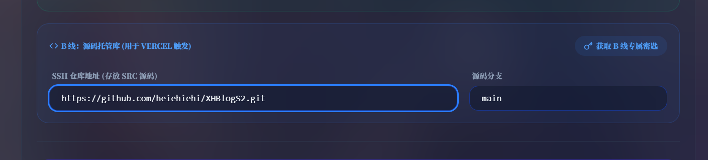

# 🌟 欢迎使用 XHBlogs！

这是一个采用 Next.js 构建的高颜值、毛玻璃（Glassmorphism）风格个人博客系统。本项目自带完善的前端展示与独立的本地后台控制台，支持 Markdown 沉浸式写作、草稿管理以及便捷的图床配置。

本指南将带你从零开始，轻松部署并使用 XHBlogs。

---
## 语言

## 写在前面

### 博客宠物展示（预览分支）

在本机控制台打开 **设置 → 宠物展示**，选择煤球或大肥鱼，再点「保存到本地博客」。旧站默认保留煤球。保存只更改所选网站的 `data/petSelection.json`，不需要整站同步；线上生效仍需按原流程部署。

大肥鱼的待机和点击动画由 [Kai0809v 在 PR #30](https://github.com/heiehiehi/XinghuisamaBlogs/pull/30) 提供，素材来自 [dsh-pet](https://github.com/PC2005-cloud/dsh-pet)，素材许可和署名见 [动画素材说明](XHBlogs/public/pets/xhblogs-big-fish/ATTRIBUTION.txt)。

### 当前版本：0.4.4（2026-11-09）

- **旧版升级修复**：补齐旧更新器遗漏的每日选刊模块。若升级后提示 `Module not found`，关闭本地控制台和网站，用官方仓库最新版的 `update.bat` 和 `update.py` 替换项目根目录中的同名文件，再运行一次 `update.bat`。
- **Windows 启动修复**：`Start.bat` 会验证可用的 Python 环境，启动失败时保留错误窗口；进入启动流程后的详细错误会写入 `my-blog-manager/startup.log`。
- **保留已有内容**：更新器不会覆盖 `posts/` 中的文章或 `data/friends.ts` 中的友链；替换的程序文件会备份到 `.update-backups/`。

### 0.4.1 更新（2026-10-23）

保留 0.4.0 的每日选刊控制台与 Agent 接入，整合两个社区 PR 的有效贡献，并修正兼容性问题。

- **壁纸分组（PR #25）**：创建、重命名、删除、切换分组与管理组内图片。修复空组意外回退旧壁纸、特殊字符读取被改写，以及旧配置缺少新字段时的保存问题。
- **编辑器改进（PR #15）**：GFM 表格支持、代码块加载与保存。保留普通正文转义与删除线，以及代码语言、缩进、空行和字面字符；完善代码围栏内标题的目录识别。
- 两项功能与 0.4.0 共存，原作者提交历史保留，维护者兼容性修复单独记录。

感谢 [PR #25 原作者 Kai](https://github.com/heiehiehi/XinghuisamaBlogs/pull/25) 和 [PR #15 原作者 ILoveFurina](https://github.com/heiehiehi/XinghuisamaBlogs/pull/15) 的贡献（名称按原 Git 提交署名）。

### 0.4.0 更新（2026-10-23）

本次新增可选的每日选刊管理，入口为 **设置 → 每日选刊**，沿用原控制台侧栏。默认关闭展示和 Agent 接收，新安装不预设专业领域，也不携带作者的个人期刊。

- 展示开关、板块文字、封面、轮播与历史范围可以配置，关闭展示保留内容。
- 自定义兴趣、排除词、来源、语言、栏目与条目数；支持任意领域。
- 新建或编辑草稿、逐条整理、阅读预览、上传封面，核对后发布到本地网站目录。
- 本机 Agent 使用独立授权，支持读取偏好、历史、提交与回执；不覆盖人工草稿或已发布日期。
- 提供首次使用引导、JSON 连接文件四步说明、客户端下载和可复制的 Codex 指令。
- 选刊服务随原后台启动，使用实际端口与“项目仓库设置”中的网站路径；切换网站时私有数据隔离。

### 快速使用每日选刊

1. 使用 `my-blog-manager/Start.bat` 启动本地控制台；先在项目仓库设置中确认网站目录。标准目录结构会默认使用同级 `XHBlogs`。
2. 在设置侧栏打开每日选刊，设置展示、兴趣与栏目，点击“保存本地设置”。
3. 在“内容与审核”建立草稿，编辑内容和来源、选择封面，再阅读预览。默认新安装没有示例期刊。
4. 核对内容、日期与原始来源后勾选确认，发布到本地网站。上线仍需走原有同步、源码提交和部署流程；保存选刊不会自动推送 Git。

### Agent 授权 JSON 怎么用

1. 在“Agent 与更新”建立独立授权，将连接 JSON 保存在博客源码之外。
2. 开启接收，选择“存为草稿，由我审核”，保存本地设置。
3. 点击“JSON 怎么用？”，填写文件完整路径，复制首次连接指令交给 Codex；连接文件由客户端读取，无需导入 Codex 设置，也无需粘贴授权全文。
4. 首次连接只读配置和历史。刷新记录确认访问，再复制整理一期指令；实际提交以回执和待审核列表为准。

电脑、本机后台和生成内容的 Agent 需要运行，控制台网页可以关闭。期望更新时间不会自动创建定时任务；DSH 本版暂未接入。字段和日期校验不能替代事实核查。

### 更新时会保留什么

更新器保留文章、友链、个人 `siteConfig.ts`、已有选刊数据和配置、已有公开图片及管理端私有授权/草稿。首次升级会补齐缺失的选刊模块初始文件。替换的程序文件保存在 `.update-backups/`，有本地未保存程序修改时停止并提示处理。

升级前仍应保存和备份自己的内容，更新后核对配置及授权状态。此更新不保证自动合并个人修改过的程序代码。PDF 审阅说明只供本地阅读，不随源码提交。

完整变更与验证范围见 [UpdateLog.md](UpdateLog.md)。0.4.1 已整合壁纸分组和编辑器两个 PR 的功能与修复。

### 历史更新摘要（0.3.1 - 0.3.2）

#### 1. 新增个人关于动态

> 关于动态类贡献度及日志显示

#### 2. 修复部分富文本编辑器bug

> 修补目前存在的编辑器bug，如超链接无法显示，引用无法显示等

#### 3. 新增灵境与等级系统

> 类创意工坊功能，等级系统可在 设置->个人名片设置 中关闭

#### 4. 网易云音乐显示bug，已修复

> 已更换API，修复网易云音乐显示bug。更新即可

## 一、快速开始部署

### 1. 环境配置

在开始之前，请确保你的电脑已安装以下运行环境，否则后续程序将无法正常启动：

- **Node.js** (版本 20.9.0 或以上（适配当前 Next.js 16）)
- **包管理器** (npm)
- **Git** (用于拉取代码与版本控制)
- **Python** (建议版本 3.10 及以上，本系统在 3.10 环境下测试通过)
- *可选：云存储/图床服务（后续会有详细配置说明）*

### 2. 博客源码更新

为了让你能轻松跟上项目的最新功能，请使用更新器对源码进行更新！
使用更新器前先保存并备份内容。更新器保留个人配置、文章、已有选刊数据与图片，并备份替换的程序文件；检测到本地程序修改时会停止，需先处理后再更新。

🛠️ 更新步骤：

第一步：获取项目主分支上的最新版更新器。使用旧版更新器升级后遇到 `Module not found` 时，也请先替换下面两个文件再重试；无需重新建博客。

#### 1 下载项目根目录下的 update.bat 和 update.py 文件。

#### 2  将下载好的 update.bat 和 update.py 移动到你本地博客项目的最外层根目录（也就是和 my-blog-manager、XHBlogs 文件夹放在一起的地方）。

如下图所示

#### 3 双击 `update.bat`

请先关闭正在运行的控制台和本地网站。更新器会从官方仓库的 `main` 下载程序文件，补齐旧更新器可能漏掉的模块，保留博客内容，并在 `.update-backups` 中备份被替换的文件。它不会改变你的 Git 远程仓库或提交。

看到 `Update complete` 再打开控制台。如果 npm 安装失败，先看窗口里的具体错误，处理后重新运行更新器即可。npm 的审计或安装脚本警告与页面的 `Module not found` 是不同的问题；不要为了补齐源码而执行 `npm audit fix --force`。

### 3. 快速开始

#### ① 启动脚本

当你完成上述环境的配置后，恭喜你，最基础的准备工作已经搞定了！
首先，进入 `my-blog-manager` 文件夹（**⚠️ 注意：请绝对不要重命名此文件夹，否则会导致环境路径解析失败！**）

双击运行文件夹中的启动脚本：
`Start.bat`
脚本会检查 Python 3.10+ 与 Node.js 20.9+，按需安装依赖并打开控制台。如果启动失败，窗口会停下来显示错误。若进入 Python 启动流程后失败，请把 `my-blog-manager/startup.log` 中与失败相关的错误发给维护者；如果尚未找到 Python，则直接提供窗口显示的错误。

#### ② 部署你的博客到 Vercel

> **提示**：本教程主要演示如何将项目部署至 Vercel，因为 Vercel 对 Next.js 框架有着最顶级的原生支持。
>
> **前提**：请确保已安装 Git，并拥有一个 GitHub 账号。**接下来的步骤请务必按顺序操作！**

> **请确保你已完成以下操作**：
>
> **第一步：本地全局配置**

设置用户名

`git config --global user.name "你的Github用户名"`

设置邮箱（必须是你在 GitHub 绑定的邮箱）

`git config --global user.email "你绑定在Github的邮箱@example.com"`

> **第二步：初始化本地仓库**
>
> 进入你的项目文件夹，执行以下CMD命令行操作：(及前端部署文件夹，这里是XHBlogs)

1. 初始化 Git 仓库，生成隐藏的 .git 文件夹
   `git init`
2. 将所有文件添加到暂存区（注意后面有个点）
   `git add .`
3. 提交到本地版本库，并添加备注
   `git commit -m "first commit"`

**1. 配置本地物理路径**
打开控制台的“设置”页面。
在拉取的源码中，包含 `XHBlogs-mananger` 和 `XHBlogs` 两个核心文件夹。请在控制台中指定 `XHBlogs` 的本地物理路径。

例如：`F:\Test2\XHBlogs`

> **关键步骤**：填入路径后，请务必点击 **[测试路径]** 进行连通性验证！！！验证通过后，再点击下方的 **[保存双轨配置]**。

**2. 在 GitHub 创建私有仓库**
登录 GitHub，新建一个用于托管博客源码的仓库（建议设置为 **Private 私有仓库** 以保护数据隐私）。

仓库名称可自定义。

获取该仓库的 SSH 地址，并将其复制粘贴到控制台的“B线”配置中：

源码分支填写为 `main`。确认无误后，再次点击 **[保存双轨配置]**。

**3. 获取并配置部署密钥**
点击控制台中的 **[获取B线专属密钥]** 按钮：

进入你的 GitHub 仓库页面，导航至 `Settings` -> `Deploy keys` 界面：

将刚才复制的密钥填入 `Key` 框中，`Title` 可随意命名（例如：`XHBlogs-Deploy-Key`）。

> **🚨 严重警告**：下方的 **Allow write access** 选项必须勾选！！！
> 设置完毕后，点击 **Add key** 保存。

**4. 初始化并推送源码**
返回本地控制台，点击 **[智能初始化双轨环境]**，静待程序执行完毕。
完成后，点击 **[仅同步源码]** 按钮：

程序将开始向 GitHub 推送代码。**在此期间，请千万不要切换页面或关闭窗口**：

进度条完成后，说明前端静态页面源码已成功托管至 GitHub。

> **此处可能出现无法推送bug**：
>
> **请尝试**
>
> 将SSH仓库地址改成如下图所示再进行初始化及同步源码
>
> 

**5. 部署至 Vercel 平台**
访问 Vercel 官网，注册账号并绑定你的 GitHub 授权！

点击 `Add New...` 添加一个新的 Project，在 Import 列表中选择你刚刚推送到 GitHub 的仓库：

例如我选择的是 `XHBlogS2`：

在 Framework Preset（框架预设）中选择 **Next.js**，然后点击 **Deploy** 按钮开始部署：

静候 Vercel 服务器构建你的博客~~

撒花！部署成功后，点击预览图即可直接访问你的专属网站！

在项目仪表盘（Dashboard）中，你可以随时查看部署状态与详细日志：

Vercel 默认会为你分配一个免费的二级域名：

---

### 问题 1：我要怎么样绑定自己的专属域名？

**答：** 这里以“阿里云”购买的域名为例（其他服务商如腾讯云、Cloudflare 等操作逻辑基本一致）。

首先登录阿里云控制台，进入【域名管理】页面：

点击对应域名右侧的【解析】按钮：

接着回到 Vercel，进入你的项目仪表盘，点击 **Settings**（或者直接点击域名旁的加号）：

在 Domains 选项卡中，输入你购买的域名（例如我的是 `xinghuisama.top`），点击 **Add** 保存：

添加后，Vercel 会提供 `A` 记录和 `CNAME` 记录的配置参数。请将这些参数完整添加到阿里云的 DNS 解析设置中：

> **注意**：添加记录时，请务必仔细核去记录类型和记录值（Value）！

配置完成后等待几分钟（DNS 传播需要时间），在 Vercel 页面点击 **Refresh** 刷新状态！！

当状态显示为正常后，你就可以通过自己的专属域名访问博客了！（例如：`www.xinghuisama.top`）。

---

## 二、更新设置及上传文件

为了保护数据安全，本控制台采用了**“操作暂存区”**机制。**请特别注意！！** 许多设置在修改后，必须主动执行“更新到本地”才能真正保存。需要执行此操作时，界面上方通常会有高亮提示。

**操作示例：修改个人简介**

修改内容后，点击 **[暂存到操作队列]**：

此时上方工具箱会提示待办操作。你可以随时撤销（清空全部），或者点击 **[更新本地]**。

> ⚠️ 注意：点击“更新本地”后，数据仅仅保存在了你的本地控制台环境中。

如果你希望让这些修改在前端博客页面生效，你必须继续点击 **[同步 Blog]**（前提是前端博客的物理路径已正确配置）：

博客文章、说说（碎碎念）、杂谈等所有内容的发布与修改，均遵循此流程。

> **💡 黄金法则**：暂存队列 -> 更新本地 -> 同步Blog

---

## 三、如何推送你的修改到线上网页？

当你在本地完成了满意的创作或设置调整，想要将其发布到公网让所有人看到时：

请牢记，在执行了任何实质性修改并点击 **[同步Blog]** 后，请打开控制台的同步部署页面：

确认“B线”地址正确无误，点击 **[仅同步源码]**。
等待 GitHub Actions 或 Vercel 自动捕获更新。稍作喝杯茶的功夫，你就能在线上页面看到最新鲜的内容了！

---

## 四、图床配置

为了优化写作体验，控制台深度整合了图床上传功能。本指南推荐使用“去不图床”（[https://7bu.top](https://7bu.top)）。
如果你习惯使用纯外链，工具台也完美支持直接插入图片 URL。如果想接入其他支持标准 API 的图床，也欢迎极客们自行尝试。

**配置流程：**

填入对应的 API Token 等信息后，你可以点击 **[发送探针测试Token]**，实时检验图床接口是否畅通。

---

## 五、AI 猫猫助理设置

博客系统内置了一只聪明的 AI 猫猫助理（默认接入 Gemini 模型）。极客玩家也可以通过修改源码接入其他大语言模型。

首先，你需要申请一个 Gemini 的 API Key（申请教程网络资源丰富，在此不赘述）。拿到 API Key 后，在控制台进行如下配置：

在本地设定好猫猫的专属系统提示词（性格）后，我们需要让线上环境也拥有调用 AI 的能力。请登录 Vercel：

在项目设置中找到 `Environment Variables`（环境变量）：

进入你的博客工程详情：

确保作用域（环境）包含线上环境，点击 **Add Environment Variables**：

安全地注入你的密钥：

- **Key** 输入：`GEMINI_API_KEY`
- **Value** 输入：你的真实 API 密钥

点击保存。下一次重新部署时，猫猫助理就会在线上苏醒了。

---

## 六、评论系统配置

本博客的评论系统基于 GitHub Issues（Gitalk 等类似方案）。你需要在 GitHub 创建一个 **Public（公开）** 仓库来专门存储网友的留言。

在控制台评论设置中，填入你的 GitHub 用户名以及这个公开仓库的名称：

**接下来，配置 OAuth 授权以允许访客登录留言：**

1. 登录 GitHub，点击右上角个人头像，进入 **Settings**（设置）。
2. 滑动到左侧菜单栏最底部，点击 **Developer settings**。
3. 在左侧选择 **OAuth Apps**，点击右上角的 **New OAuth App**。

**关键应用信息填写指南：**

| 字段名称                       | 填写建议                                                                           |
| ------------------------------ | ---------------------------------------------------------------------------------- |
| **Application name**           | 自定义名称，例如：`My-Blog-Comments`                                               |
| **Homepage URL**               | 你的博客**首页完整地址** (例如 `https://www.xinghuisama.top`)                      |
| **Application description**    | 可选填                                                                             |
| **Authorization callback URL** | **核心参数**：必须填写你的博客域名。如果经常本地调试，可填 `http://localhost:3000` |

**提取核心密钥：**

1. 提交注册（Register application）。
2. 在跳转页面即可看到 **Client ID**，这是所需的第一项数据。
3. 点击下方的 **Generate a new client secret** 生成密钥。
4. **🚨 立刻将这串密钥复制并妥善保存！** 出于安全机制，离开此页面后该密钥将永远隐藏。

将这组 `Client ID` 和 `Client Secret` 准确填入控制台的对应栏目中，保存即可激活评论功能。

---

## 七、网易云音乐挂件设置

想给博客配上 BGM 吗？
通过电脑浏览器打开 **网易云音乐网页版**。搜索并进入你喜欢的歌曲详情页，观察浏览器地址栏，URL 中的数字即为歌曲的专属 ID：

将这串 ID 复制并粘贴到控制台的搜索框中，即可一键将该歌曲收录进你的博客歌单库！

---

## 写在最后

XHBLogs 还有诸多隐藏的细节功能，期待极客朋友们在实际使用中慢慢探索。本项目旨在提供一套开箱即用的前端静态展示与后台管理方案。如果你是资深开发者，觉得控制台操作仍有优化空间，完全可以基于 Next.js 源码进行二次开发，甚至手搓 Markdown 进行部署！

**如果你觉得这个项目对你有帮助，请务必在 GitHub 上为我点亮一颗 ⭐ Star！每一颗星都是博主持续维护更新的最大动力。谢谢大家！**

## 许可证

> 本项目采用 [CC BY-NC 4.0](https://creativecommons.org/licenses/by-nc/4.0/) 许可协议。允许免费学习、分享和二次修改后发布（二次开源发布需提及原作者），但**严禁用于任何商业用途**。
